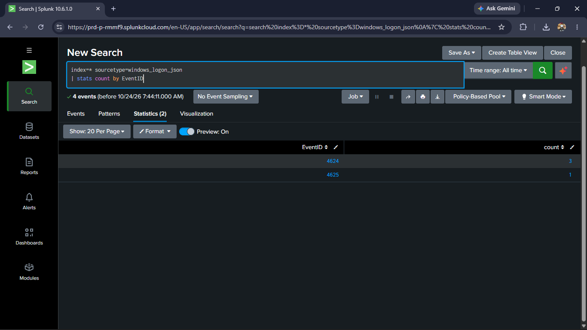
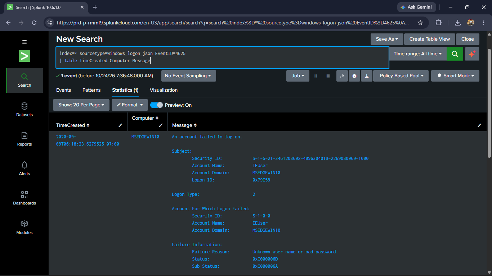
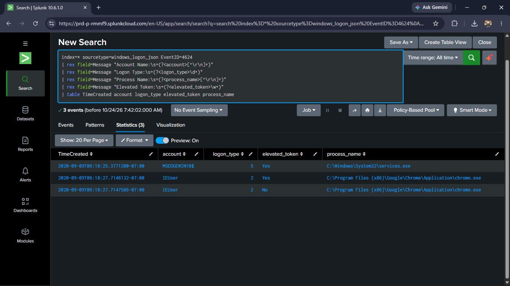
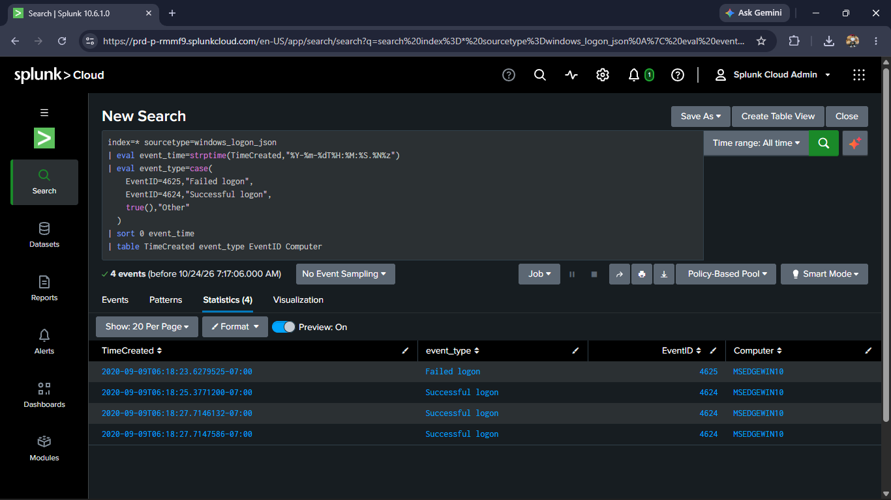

# Windows Logon Event Investigation | PowerShell & Splunk

## Overview

This project investigates Windows Security logon events using PowerShell and Splunk Cloud. The objective was to analyze failed and successful logons, extract relevant authentication details, and reconstruct an event timeline from an EVTX sample.

**Tools:** PowerShell · Splunk Cloud · SPL · Windows Event Logs

**Dataset:** `CA_4624_4625_LogonType2_LogonProc_chrome.evtx` from the [EVTX-ATTACK-SAMPLES repository](https://github.com/sbousseaden/EVTX-ATTACK-SAMPLES)

## Investigation Objectives

- Import Windows event data into Splunk.
- Analyze Event ID 4625 (failed logon) and Event ID 4624 (successful logon).
- Extract account, logon type, process, and authentication failure details.
- Reconstruct a timeline using original event timestamps.
- Document findings, limitations, and recommended follow-up.

## Key Findings

- Analyzed **4 Windows logon events**: 3 successful logons and 1 failed logon.
- Identified a failed interactive logon for `IEUser` with substatus `0xC000006A`, indicating an incorrect password.
- Identified two Chrome-associated interactive logon sessions for `IEUser`, with elevated and non-elevated tokens and linked logon IDs.
- Identified a separate Logon Type 5 service logon associated with `services.exe`.
- The analyzed failed-logon event did not contain a source IP address.

**Conclusion:** The available sample does not establish malicious activity or confirm a compromise. Additional endpoint and authentication telemetry would be required to determine whether the observed sequence was suspicious.

## Evidence

### 1. Event Counts

### 2. Failed Logon Analysis

### 3. Successful Logons

### 4. Event Timeline

## Repository Contents

- [`report/incident_report.md`](report/incident_report.md) — Investigation report, timeline, findings, limitations, and recommendations.
- [`queries/windows_logon_investigation.spl`](queries/windows_logon_investigation.spl) — SPL searches used during the investigation.
- [`screenshots/`](screenshots/) — Visual evidence captured from Splunk.

## Skills Demonstrated

- Windows Security Event Log analysis
- Authentication event investigation
- SPL search and field extraction
- Event timeline reconstruction
- Basic endpoint investigation and evidence documentation
- Evidence-based reporting and acknowledgment of investigative limitations

## Data and Timestamp Notes

The sample contains only four events and is not sufficient to establish compromise. Splunk's indexed timestamp did not preserve the original event chronology in this case, so the original `TimeCreated` field was used to reconstruct the timeline.

This is a controlled, sample-based investigation for cybersecurity learning and portfolio demonstration.
